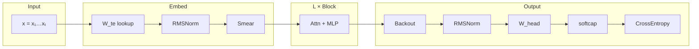
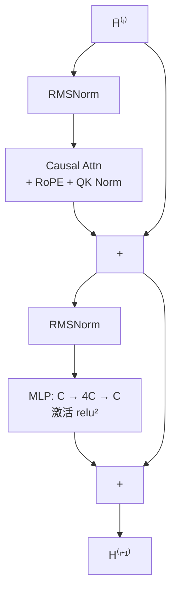
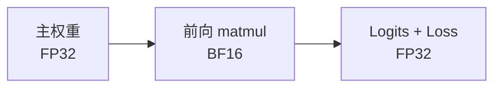

# nanochat GPT 预训练架构

> **图内说明：** Mermaid 节点不支持 LaTeX 渲染，图中用 Unicode/简写；精确公式见各节 `$$...$$` 块。

> 实现：`nanochat/gpt.py` · 训练入口：`scripts/base_train.py`

---

## 符号表

| 符号 | 含义 | 默认值 / 关系 |
|------|------|---------------|
| $T$ | 序列长度 | $2048$ |
| $V$ | 词表大小 | $\approx 32768$ |
| $L$ | Transformer 层数（`depth`） | 用户指定，如 $12, 26$ |
| $C$ | 隐藏维（channel 数，$n_{\text{embd}}$） | $C = \lceil L \cdot 64 / 128 \rceil \cdot 128$ |
| $H$ | 注意力头数 | $H = C / 128$ |
| $D$ | 每头维度（`head_dim`） | $D = 128$ |
| $H_{\text{kv}}$ | KV 头数（当前等于 $H$，即 MHA） | $H_{\text{kv}} = H$ |
| $W_i$ | 第 $i$ 层注意力窗口 | S 层 $512$，L 层 $T$；末层恒为 $T$ |
| $x_t$ | 第 $t$ 个 token ID | $x_t \in \{1,\ldots,V\}$ |
| $y_t$ | 训练目标（下一 token） | $y_t = x_{t+1}$ |
| $\mathbf{h}_t$ | 位置 $t$ 的 hidden 向量 | $\mathbf{h}_t \in \mathbb{R}^C$ |

**维度关系（d26 例）：** $L=26,\; C=1664,\; H=13,\; D=128$。

---

## 总览数据流

---

## 1. 输入与目标

预训练 dataloader 输出 token 序列 $\mathbf{x}$ 与右移标签：

$$
y_t = x_{t+1}, \quad t = 1, 2, \ldots, T-1
$$

---

## 2. Token Embedding

$$
\mathbf{e}_t = W_{\text{te}}[x_t] \in \mathbb{R}^C, \qquad W_{\text{te}} \in \mathbb{R}^{V \times C}
$$

无绝对位置编码；位置信息由 RoPE 注入。

---

## 3. RMSNorm（无可学习参数）

$$
\text{RMSNorm}(\mathbf{h}) = \frac{\mathbf{h}}{\sqrt{\dfrac{1}{C}\sum_{j=1}^{C} h_j^2 + \varepsilon}}
$$

$$
\tilde{\mathbf{e}}_t = \text{RMSNorm}(\mathbf{e}_t)
$$

---

## 4. Smear（二元组融合）

$$
\hat{\mathbf{e}}_1 = \tilde{\mathbf{e}}_1
$$

$$
\hat{\mathbf{e}}_t = \tilde{\mathbf{e}}_t + g_t \,\tilde{\mathbf{e}}_{t-1}, \quad t \ge 2
$$

$$
g_t = \lambda_s \cdot \sigma\!\left(W_s \,\tilde{\mathbf{e}}_t^{(1:24)}\right)
$$

- $\lambda_s \in \mathbb{R}$：可学习标量（初值 $0$）
- $W_s \in \mathbb{R}^{1 \times 24}$，$\sigma$ 为 sigmoid

保存初始流：$\mathbf{H}_0 = \hat{\mathbf{E}} \in \mathbb{R}^{T \times C}$。

---

## 5. Transformer Block（重复 $L$ 次）

进入第 $i$ 层时残差流为 $\mathbf{H}^{(i)}$。

### 5.1 层前混合

$$
\bar{\mathbf{H}}^{(i)} = \alpha_i \,\mathbf{H}^{(i)} + \beta_i \,\mathbf{H}_0
$$

$\alpha_i$（`resid_lambdas`）、$\beta_i$（`x0_lambdas`）为可学习标量。

### 5.2 Block 结构

$$
\mathbf{H}'^{(i)} = \bar{\mathbf{H}}^{(i)} + \text{Attn}^{(i)}\!\left(\text{RMSNorm}(\bar{\mathbf{H}}^{(i)})\right)
$$

$$
\mathbf{H}^{(i+1)} = \mathbf{H}'^{(i)} + \text{MLP}^{(i)}\!\left(\text{RMSNorm}(\mathbf{H}'^{(i)})\right)
$$

---

## 6. 因果自注意力（第 $i$ 层）

### 6.1 Q / K / V 投影

设 $\mathbf{x}_t = \text{RMSNorm}(\bar{\mathbf{h}}_t^{(i)})$：

$$
\mathbf{q}_{t,h} = W_Q^{(i)} \mathbf{x}_t \big|_h \in \mathbb{R}^D, \quad
\mathbf{k}_{t,h} = W_K^{(i)} \mathbf{x}_t \big|_h, \quad
\mathbf{v}_{t,h} = W_V^{(i)} \mathbf{x}_t \big|_h
$$

$W_Q, W_K, W_V, W_O \in \mathbb{R}^{C \times C}$（无 bias）。

### 6.2 Value Embedding（ResFormer，部分层启用）

$$
\mathbf{v}_{t,h} \leftarrow \mathbf{v}_{t,h} + \gamma_{t,h}\, W_{\text{ve}}^{(i)}[x_t]\big|_h
$$

$$
\gamma_{t,h} = 3 \cdot \sigma\!\left(W_g^{(i)} \mathbf{x}_t^{(1:12)}\right)_h \in (0, 3)
$$

启用层：交替层 + 最后一层。

### 6.3 RoPE

对 $\mathbf{q}_{t,h}, \mathbf{k}_{t,h}$ 的相邻维度对 $(2j, 2j+1)$ 旋转：

$$
\begin{pmatrix} q'_{2j} \\ q'_{2j+1} \end{pmatrix}
=
\begin{pmatrix}
\cos\theta_{t,j} & \sin\theta_{t,j} \\
-\sin\theta_{t,j} & \cos\theta_{t,j}
\end{pmatrix}
\begin{pmatrix} q_{2j} \\ q_{2j+1} \end{pmatrix},
\quad
\theta_{t,j} = t \cdot 100000^{-2j/D}
$$

### 6.4 QK Norm + 缩放

$$
\mathbf{q}_{t,h} \leftarrow 1.2 \cdot \text{RMSNorm}(\mathbf{q}_{t,h}), \qquad
\mathbf{k}_{t,h} \leftarrow 1.2 \cdot \text{RMSNorm}(\mathbf{k}_{t,h})
$$

### 6.5 因果滑动窗口注意力

可 attend 集合（第 $i$ 层窗口 $W_i$）：

$$
\mathcal{A}_t = \left\{ s \;\middle|\; \max(1,\, t - W_i + 1) \le s \le t \right\}
$$

$$
a_{t,h,s} = \frac{\exp\!\left(\mathbf{q}_{t,h}^\top \mathbf{k}_{s,h} / \sqrt{D}\right)}
{\sum_{s' \in \mathcal{A}_t} \exp\!\left(\mathbf{q}_{t,h}^\top \mathbf{k}_{s',h} / \sqrt{D}\right)}
$$

$$
\mathbf{o}_{t,h} = \sum_{s \in \mathcal{A}_t} a_{t,h,s}\, \mathbf{v}_{s,h}, \qquad
\text{Attn}(\cdot) = W_O \,\text{concat}_h(\mathbf{o}_{t,h})
$$

**窗口模式 `SSSL`（按层循环，末层强制 L）：**

| 类型 | $W_i$ |
|------|-------|
| S（Short） | $512$ |
| L（Long） | $T = 2048$ |

---

## 7. MLP

$$
\mathbf{u}_t = W_1^{(i)} \mathbf{z}_t \in \mathbb{R}^{4C}, \qquad
\mathbf{m}_t = \big(\max(0,\, \mathbf{u}_t)\big)^{\odot 2}
$$

$$
\text{MLP}^{(i)}(\mathbf{z}_t) = W_2^{(i)} \mathbf{m}_t \in \mathbb{R}^{C}
$$

---

## 8. Backout

第 $\lfloor L/2 \rfloor$ 层输出记为 $\mathbf{H}^{\text{mid}}$：

$$
\mathbf{H}^{(\text{out})} = \mathbf{H}^{(L)} - \lambda_b \,\mathbf{H}^{\text{mid}}
$$

$\lambda_b$ 可学习，初值 $0.2$。

---

## 9. 输出头与损失

$$
\mathbf{h}_t^{\text{final}} = \text{RMSNorm}(\mathbf{h}_t^{(\text{out})})
$$

$$
z_{t,v} = \left(W_{\text{head}}\, \mathbf{h}_t^{\text{final}}\right)_v, \qquad W_{\text{head}} \in \mathbb{R}^{C \times V}
$$

**Logit softcap**（$c = 15$，fp32 计算）：

$$
\ell_{t,v} = c \cdot \tanh\!\left(\frac{z_{t,v}}{c}\right)
$$

**交叉熵：**

$$
p_{t,v} = \frac{\exp(\ell_{t,v})}{\sum_{v'=1}^{V} \exp(\ell_{t,v'})}, \qquad
\mathcal{L} = -\frac{1}{T-1}\sum_{t=1}^{T-1} \log p_{t,\, y_t}
$$

---

## 10. 维度变化（d26）

| 阶段 | 张量 shape（每 token） |
|------|------------------------|
| Embedding | $\mathbb{R}^{C},\; C=1664$ |
| Q / K / V | $H \times D = 13 \times 128$ |
| MLP 中间 | $\mathbb{R}^{4C},\; 6656$ |
| 最终 hidden | $\mathbb{R}^{C}$ |
| Logits | $\mathbb{R}^{V},\; V \approx 32768$ |

---

## 11. 参数量

**每层 Attention：**

$$
P_{\text{attn}}^{(i)} = \underbrace{4C^2}_{W_Q,W_K,W_V,W_O} + \underbrace{12 \cdot H}_{W_g \text{（若有 VE）}}
$$

**每层 MLP：**

$$
P_{\text{mlp}}^{(i)} = 8C^2
$$

**Value Embedding：**

$$
P_{\text{VE}} \approx \left\lceil \frac{L+1}{2} \right\rceil \cdot V \cdot HD
$$

**Embedding + 输出头（不共享）：**

$$
P_{\text{emb}} = 2VC
$$

**总计：**

$$
P_{\text{total}} = 2VC + P_{\text{VE}} + L \cdot 12C^2 + \text{标量}
$$

| depth | $C$ | $H$ | $P_{\text{total}}$ |
|-------|-----|-----|---------------------|
| d12 | 768 | 6 | $2.86 \times 10^8$ |
| d20 | 1280 | 10 | $8.97 \times 10^8$ |
| d26 | 1664 | 13 | $1.68 \times 10^9$ |

---

## 12. 计算量

**每 token 训练 FLOPs（前向 + 反向）：**

$$
F_{\text{token}} = 6 \cdot P_{\text{matmul}} + \sum_{i=0}^{L-1} 12\, H D\, W_i
$$

- $P_{\text{matmul}}$：所有 `Linear` 权重参数量
- 系数 $6 = 2$（前向）$+\, 4$（反向）

**整次预训练：**

$$
F_{\text{train}} = F_{\text{token}} \cdot N_{\text{tokens}}, \qquad
N_{\text{tokens}} = B_{\text{total}} \cdot N_{\text{steps}}
$$

$$
N_{\text{steps}} = \frac{\rho \cdot P_{\text{scale}}}{B_{\text{total}}}, \qquad
P_{\text{scale}} = P_{\text{transformer}} + P_{\text{head}}
$$

| depth | $F_{\text{token}}$ | $N_{\text{tokens}}$（$\rho=12$） | $F_{\text{train}}$ |
|-------|----------------------|----------------------------------|---------------------|
| d12 | $7.6 \times 10^8$ | $1.3 \times 10^9$ | $\sim 10^{18}$ |
| d26 | $6.0 \times 10^9$ | $1.1 \times 10^{10}$ | $\sim 6.6 \times 10^{19}$ |

---

## 13. 浮点精度

| 组件 | 精度 |
|------|------|
| 优化器主权重 | FP32 |
| 前向 matmul（A100/H100 默认） | BF16 |
| Embedding 存储 | BF16 |
| Logits / Loss | FP32 |
| 可选 `--fp8`（H100+） | FP8 matmul + FP32 scale |

---

## 14. 端到端公式链

$$
\boxed{
\mathbf{x}
\xrightarrow{W_{\text{te}}}
\mathbf{E}
\xrightarrow{\text{RMSNorm}}
\tilde{\mathbf{E}}
\xrightarrow{\text{Smear}}
\mathbf{H}_0
\xrightarrow{L \times \text{Block}}
\mathbf{H}^{(L)}
\xrightarrow{-\lambda_b \mathbf{H}^{\text{mid}}}
\mathbf{H}^{(\text{out})}
\xrightarrow{\text{RMSNorm}}
\xrightarrow{W_{\text{head}}}
\boldsymbol{\ell}
\xrightarrow{\text{CE}}
\mathcal{L}
}
$$

---

## 15. 深度学习常用数学符号速查

> 约定：小写斜体 = 标量；粗体小写 = 向量；粗体大写 = 矩阵；花体 = 集合/损失。下标 $i,j,t$ 常表示索引，上标 $(l)$ 常表示第 $l$ 层。

### 15.1 基本对象

| 对象 | 常见写法 | 说明 |
|------|----------|------|
| 标量 | $a,\; x,\; \alpha,\; \lambda$ | 单个数；希腊字母常作超参 |
| 向量 | $\mathbf{x},\; \mathbf{h},\; \mathbf{w}$ | 列向量为主，$\mathbf{x} \in \mathbb{R}^{d}$ |
| 矩阵 | $\mathbf{W},\; \mathbf{A},\; \mathbf{H}$ | $\mathbf{W} \in \mathbb{R}^{m \times n}$ |
| 张量 | $\mathcal{X},\; \mathsf{X}$ | 三维及以上；论文里也常仍用粗体 |
| 集合 | $\mathcal{D},\; \mathcal{A}_t$ | 数据集、可 attend 位置集合等 |
| 转置 | $\mathbf{W}^\top$ 或 $\mathbf{W}^{T}$ | |
| 逆 / 伪逆 | $\mathbf{W}^{-1},\; \mathbf{W}^{+}$ | |
| 逐元素积 | $\mathbf{a} \odot \mathbf{b}$ | Hadamard product |
| 范数 | $\|\mathbf{x}\|_2,\; \|\mathbf{W}\|_F$ | L2、Frobenius |

**维度标注习惯：**

$$
\mathbf{x} \in \mathbb{R}^{C}, \quad
\mathbf{W} \in \mathbb{R}^{C_{\text{out}} \times C_{\text{in}}}, \quad
\mathbf{H} \in \mathbb{R}^{B \times T \times C}
$$

- $B$：batch size
- $T$：序列长度（时间 / token 维）
- $C$：channel / 隐藏维（$n_{\text{embd}}$）
- $V$：词表大小
- $H$：注意力头数；$D$：每头维度（常有 $C = H \cdot D$）

### 15.2 输入、输出、中间表示

| 含义 | 符号 | 典型 shape |
|------|------|------------|
| 输入 token / 特征 | $\mathbf{x},\; x_t,\; \mathbf{X}$ | $x_t$ 标量 ID；$\mathbf{X} \in \mathbb{R}^{B \times T}$ |
| 目标 / 标签 | $y,\; y_t,\; \mathbf{y}$ | 分类标签或下一 token |
| 预测 | $\hat{y},\; \hat{\mathbf{y}}$ | |
| Embedding | $\mathbf{e}_t,\; \mathbf{E}$ | $\mathbf{e}_t \in \mathbb{R}^{C}$ |
| Hidden / 残差流 | $\mathbf{h},\; \mathbf{H}^{(l)}$ | 第 $l$ 层输出 |
| Logits | $\mathbf{z},\; \boldsymbol{\ell},\; \mathbf{o}$ | $\in \mathbb{R}^{V}$（未归一化） |
| 概率 | $p,\; \mathbf{p},\; p(y \mid x)$ | Softmax 后 |
| Channel 维 | $C,\; d_{\text{model}},\; n_{\text{embd}}$ | 同一概念多种写法 |

### 15.3 权重与偏置

| 含义 | 符号 |
|------|------|
| 权重矩阵 | $\mathbf{W},\; \mathbf{W}^{(l)},\; W_{ij}$ |
| 偏置 | $\mathbf{b},\; b$ |
| 线性层 | $\mathbf{y} = \mathbf{W}\mathbf{x} + \mathbf{b}$ |
| Embedding 表 | $\mathbf{E},\; W_{\text{te}}$ |
| 输出头 | $W_{\text{head}},\; \mathbf{W}_{\text{lm}}$ |
| 可学习标量 | $\lambda,\; \alpha,\; \beta,\; \gamma$ |
| 全部参数 | $\theta,\; \boldsymbol{\theta}$ |

Attention 里常见拆分：

$$
\mathbf{Q} = \mathbf{X}\mathbf{W}_Q, \quad
\mathbf{K} = \mathbf{X}\mathbf{W}_K, \quad
\mathbf{V} = \mathbf{X}\mathbf{W}_V, \quad
\text{输出} = \text{Attn}(\mathbf{Q},\mathbf{K},\mathbf{V})\,\mathbf{W}_O
$$

### 15.4 损失函数

| 含义 | 符号 |
|------|------|
| 损失（标量） | $\mathcal{L},\; L,\; J$ |
| 经验风险 | $\mathcal{L}(\theta) = \dfrac{1}{N}\sum_{i=1}^{N} \ell(f_\theta(x_i), y_i)$ |
| 交叉熵 | $\ell_{\text{CE}} = -\sum_{v} y_v \log p_v$ 或 $-\log p_{y}$ |
| MSE | $\ell_{\text{MSE}} = \|\hat{\mathbf{y}} - \mathbf{y}\|_2^2$ |
| 正则项 | $\Omega(\theta),\; \lambda \|\theta\|_2^2$ |
| 总目标 | $\mathcal{L}_{\text{total}} = \mathcal{L}_{\text{data}} + \lambda \Omega$ |

因果 LM（nanochat 预训练）：

$$
\mathcal{L} = -\frac{1}{T-1}\sum_{t=1}^{T-1} \log p_\theta(y_t \mid x_{\le t}), \quad y_t = x_{t+1}
$$

SFT 时常对 mask 位置忽略：$\mathcal{L}$ 只在 assistant token（$\text{mask}=1$）上平均。

### 15.5 梯度、反向传播、优化

| 含义 | 符号 |
|------|------|
| 梯度 | $\nabla_\theta \mathcal{L},\; \dfrac{\partial \mathcal{L}}{\partial \theta}$ |
| 对某层激活的梯度 | $\dfrac{\partial \mathcal{L}}{\partial \mathbf{h}^{(l)}}$ |
| 学习率 | $\eta,\; \alpha,\; \text{lr}$ |
| 参数更新（SGD） | $\theta \leftarrow \theta - \eta \nabla_\theta \mathcal{L}$ |
| 动量 | $m,\; \beta_1$ |
| Adam 二阶矩 | $v,\; \beta_2$ |
| 梯度裁剪 | $\|\nabla\| \leftarrow \min\!\left(1,\; \dfrac{c}{\|\nabla\|}\right)\nabla$ |

反向传播（链式法则，示意）：

$$
\frac{\partial \mathcal{L}}{\partial \mathbf{W}^{(l)}}
=
\frac{\partial \mathcal{L}}{\partial \mathbf{h}^{(l)}}
\cdot
\frac{\partial \mathbf{h}^{(l)}}{\partial \mathbf{W}^{(l)}}
$$

常见简写：$\mathbf{g} = \nabla_\theta \mathcal{L}$。

### 15.6 残差连接

标准残差块：

$$
\mathbf{h}^{(l+1)} = \mathbf{h}^{(l)} + \mathcal{F}\!\left(\mathbf{h}^{(l)};\, \theta^{(l)}\right)
$$

- $\mathbf{h}^{(l)}$：残差流（shortcut）
- $\mathcal{F}$：子层（Attention 或 MLP）
- Pre-Norm 常见写法：$\mathbf{h} + \mathcal{F}(\text{Norm}(\mathbf{h}))$

nanochat 相关：

$$
\bar{\mathbf{H}}^{(i)} = \alpha_i \mathbf{H}^{(i)} + \beta_i \mathbf{H}_0
\quad\text{（层前混合）}
$$

$$
\mathbf{H}^{(\text{out})} = \mathbf{H}^{(L)} - \lambda_b \mathbf{H}^{\text{mid}}
\quad\text{（Backout：减中层）}
$$

### 15.7 Attention

| 含义 | 符号 |
|------|------|
| Query / Key / Value | $\mathbf{Q},\; \mathbf{K},\; \mathbf{V}$ |
| 注意力权重 | $\mathbf{A},\; a_{ts},\; \alpha_{ij}$ |
| Softmax | $\mathrm{softmax}(\cdot)$ |
| 缩放点积 | $\mathrm{Attention}(\mathbf{Q},\mathbf{K},\mathbf{V}) = \mathrm{softmax}\!\left(\dfrac{\mathbf{Q}\mathbf{K}^\top}{\sqrt{D}}\right)\mathbf{V}$ |
| 因果 mask | $-\text{mask}\}$ 或 $-\infty$ 填未来位置 |
| 窗口大小 | $W,\; W_i$ |
| 头索引 | $h = 1,\ldots,H$ |

多头拼接：

$$
\text{MultiHead} = \mathrm{Concat}(\mathbf{o}_1,\ldots,\mathbf{o}_H)\,\mathbf{W}_O
$$

### 15.8 激活、归一化、概率

| 含义 | 符号 |
|------|------|
| ReLU / GELU / SiLU | $\mathrm{ReLU},\; \mathrm{GELU},\; \sigma_{\text{silu}}$ |
| Sigmoid | $\sigma(x) = \dfrac{1}{1+e^{-x}}$ |
| Softmax | $\mathrm{softmax}(\mathbf{z})_i = \dfrac{e^{z_i}}{\sum_j e^{z_j}}$ |
| LayerNorm / RMSNorm | $\mathrm{LN}(\cdot),\; \mathrm{RMSNorm}(\cdot)$ |
| 期望 / 方差 | $\mathbb{E}[\cdot],\; \mathrm{Var}(\cdot)$ |
| 指示函数 | $\mathbb{1}[\text{条件}]$ |

nanochat MLP 激活（relu²）：

$$
\mathbf{m} = \big(\max(0,\, \mathbf{u})\big)^{\odot 2}
$$

### 15.9 训练过程常用量

| 含义 | 符号 |
|------|------|
| 步数 / 迭代 | $t,\; \text{step},\; k$ |
| Epoch | $e$ |
| Batch size | $B,\; N_{\text{batch}}$ |
| 学习率调度 | $\eta_t,\; \eta(t)$ |
| Warmup / Warmdown | 常用比例或步数描述 |
| FLOPs | $F,\; C$（算力预算，Chinchilla 用 $C$） |
| 参数量 | $N,\; |\theta|,\; P$ |
| Token 数 | $D$（Chinchilla 数据量） |

### 15.10 排版习惯（读论文时）

| 习惯 | 例子 |
|------|------|
| 层用上标括号 | $\mathbf{h}^{(l)},\; \mathbf{W}^{(l)}$ |
| 时间 / token 用下标 | $x_t,\; \mathbf{h}_t$ |
| 样本用下标 | $(x_i, y_i)$ |
| 估计量加帽 | $\hat{y},\; \hat{\theta}$ |
| 最优加星 | $\theta^\star,\; \theta^{*}$ |
| 临时 / 中间量加波浪 | $\tilde{\mathbf{e}},\; \bar{\mathbf{H}}$ |
| 特殊集合用花体 | $\mathcal{L},\; \mathcal{D},\; \mathcal{A}_t$ |

### 15.11 与 nanochat / 本文符号对照

| 本文符号 | 通用含义 |
|----------|----------|
| $T, V, L, C, H, D$ | 序列长、词表、层数、隐藏维、头数、头维 |
| $W_{\text{te}}, W_{\text{head}}$ | token embedding、输出投影 |
| $\mathbf{H}_0, \mathbf{H}^{(i)}$ | smear 后初始流、第 $i$ 层残差流 |
| $\alpha_i, \beta_i$ | resid / x0 混合系数 |
| $\lambda_s, \lambda_b$ | smear / backout 标量 |
| $\boldsymbol{\ell}, \mathcal{L}$ | softcap 后 logits、交叉熵损失 |
| $W_i$（窗口） | 第 $i$ 层滑动窗口长度（勿与权重 $\mathbf{W}$ 混淆） |

> **易混点：** 大写 $H$ 在本文 = 头数；粗体 $\mathbf{H}$ = hidden 矩阵。权重 $\mathbf{W}$ 与窗口 $W_i$ 同字母不同含义，读公式时看是否粗体、是否带层下标。
